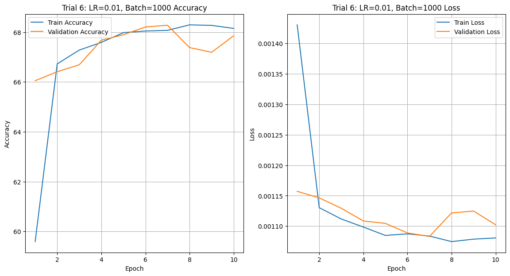

# Quick, Draw! Sketch Classification with ResNet18

This project classifies hand-drawn sketches from Google's [Quick, Draw!](https://github.com/googlecreativelab/quickdraw-dataset) dataset into 30 categories.
It uses transfer learning on an ImageNet-pretrained ResNet18, runs a random hyperparameter search, and ends with an error analysis.

> **Author:** Francesco Fabrizi

---

## Dataset

The data comes from 30 classes of the Quick, Draw! *numpy bitmap* files: bus, pool, banana, basket, bread, car, fish, frog, hamburger, helmet, key, lion, mug, oven, panda, pizza, pig, camel, dog, face, horse, ice cream, moon, microphone, onion, pillow, potato, pond, bat and bear.

- The first 10,000 drawings of each class are used, for 300,000 images in total.
- The split is 70% train, 10% validation and 20% test.
- The 28×28 grayscale bitmaps are replicated to 3 channels and resized to 224×224 to match the ResNet input. Random horizontal flip is used as augmentation.

---

## Method

- **Model:** ResNet18 pretrained on ImageNet, with the final fully connected layer replaced by a 30-class head.
- **Training:** only the new head is optimised (Adam, cross-entropy), for 10 epochs per run.
- **Hyperparameter search:** 7 random trials over batch size {500, 1000, 2000} and learning rate {1e-2, 1e-3, 1e-4}. Each epoch's train and validation metrics are logged to CSV, and the best checkpoint of each trial is saved.

---

## Results

Test-set results of the 7 trials:

| Trial | Test accuracy | Macro F1 |
|-------|---------------|----------|
| 1 | 67.7% | 0.671 |
| 2 | 62.3% | 0.616 |
| 3 | 68.8% | 0.684 |
| 4 | 69.0% | 0.687 |
| 5 | 68.7% | 0.682 |
| 6 | **69.4%** | **0.694** |
| 7 | 62.2% | 0.614 |

Training and validation curves of trial 6 (learning rate 0.01, batch size 1000), the trial with the best test accuracy:

Accuracy plateaus around 69%. A likely reason is that only the classifier head is trained, and ImageNet features are not a good fit for black-and-white line drawings. Fine-tuning the whole backbone would be the natural next step.

---

## Visualisation and error analysis

Random test images with their predicted labels:

Misclassified images with their true and predicted labels:

  
  

Confusion matrix over all 30 classes. Most errors happen between visually similar sketches.

---

## Repository contents

| File | Description |
|------|-------------|
| `Quick Draw.ipynb` | Notebook with code, outputs and plots |
| `Quick Draw.py` | Same code exported as a Python script |

---

## Running it

The notebook downloads the data from Google Cloud Storage by itself and is meant to run on Google Colab with a GPU.
Checkpoints and CSV logs are saved to Google Drive, so you need to change the `root` path to your own folder.

**[Open in Colab](https://colab.research.google.com/drive/1K3uySK59roQNokGht7QIwH6y3RDMzO5Q?usp=sharing)**
